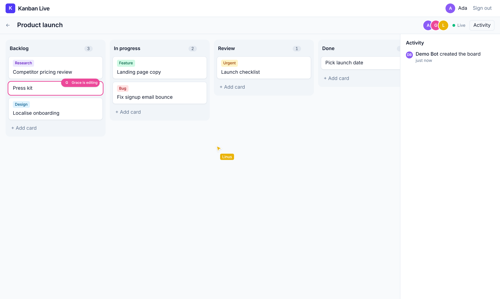
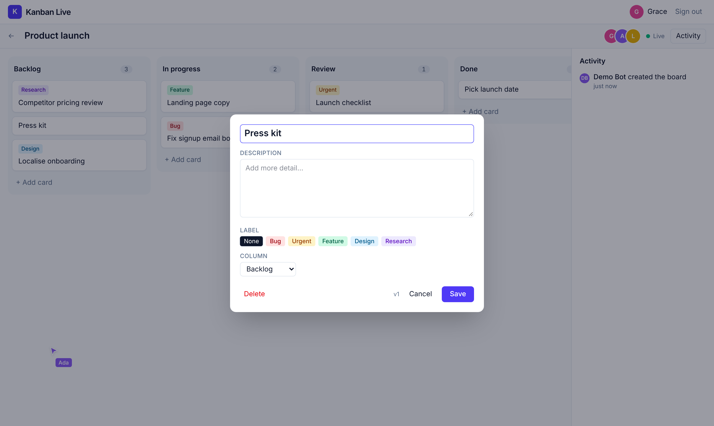
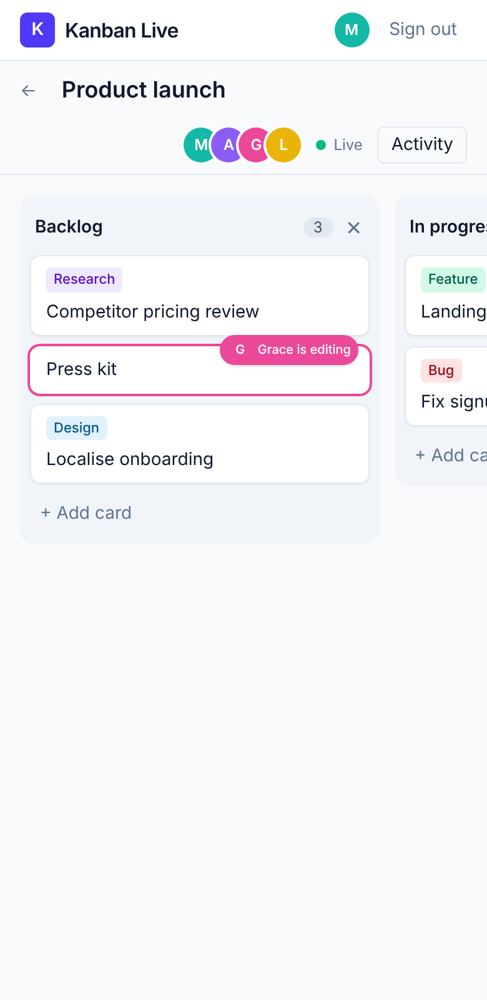

# Kanban Live

[](https://github.com/GodfreysDragon/realtime-kanban/actions/workflows/ci.yml)

A real-time collaborative Kanban board built with **Laravel 13, Laravel Reverb (WebSockets), Laravel Echo and Vue 3**.
Open it in two browsers and every change shows up in both instantly: cards, moves, edits, who's online, where their
cursor is, and what they're editing.



<details>
<summary>More screenshots</summary>

Grace's view while she edits the card, with Ada's cursor:



Phone width:



</details>

## Running it

Requirements: PHP 8.4+, Composer, Node 20+.

```sh
composer install
cp .env.example .env            # includes local Reverb credentials
php artisan key:generate
php artisan migrate --seed      # seeds a "Product launch" demo board
npm install && npm run build
composer run dev                # app server, Reverb, queue worker and Vite together
```

Then open http://localhost:8000 in one browser, open it again in a private window, and join with two different names.

If you run the processes by hand, the two that matter are `php artisan serve` and `php artisan reverb:start`.

## What happens in real time

| Feature | Mechanism |
|---|---|
| Cards and columns created, edited, moved and deleted | Server events on a **presence channel** `presence-board.{id}` |
| Who's online (avatar stack) | Presence channel membership (`here` / `joining` / `leaving`) |
| Live cursors | Client **whispers** (`client-cursor`), throttled to about 20/s, never touch PHP |
| "Ada is editing" and "Ada is moving" badges | Whispers (`client-editing`, `client-dragging`) |
| Activity feed | `activity.recorded` event, sent to everyone including the actor |
| Connection status and resync | pusher-js `state_change`. After a reconnect the board snapshot is fetched again |

## Design decisions

### Sync model
The REST snapshot (`GET /api/boards/{id}`) is the source of truth. Every server event carries the **full row** rather
than a diff, so applying an event is idempotent and replays are harmless. The snapshot is fetched once straight away for a fast
first paint and again when the channel subscription succeeds, because only a snapshot taken after that moment is
guaranteed not to miss an event. While a snapshot is loading, incoming events are buffered and replayed after it, and if
loads overlap only the newest is applied. Pusher-protocol servers don't replay missed messages, but every reconnect
re-subscribes, so the same hook fetches the snapshot again.

### No echo of your own changes
The client applies its own changes optimistically. Every API call sends `X-Socket-ID`, and the server broadcasts with
`->toOthers()`, so the tab that made a change never receives it back. The HTTP response then replaces the optimistic
value with the server's.

### Ordering with fractional indexes
Each card has a float `position`. Dropping a card between two others gives it the midpoint of their positions, so a
move rewrites exactly **one row**, and two people reordering different cards never conflict. The client sends the card
it was dropped *after* (`after_id`) rather than an index, and the server resolves it against the current database
state. If that neighbour has meanwhile been moved elsewhere, the card goes to the bottom instead of failing. Repeated
drops into the same gap halve it each time. Below `1e-6` the column is renumbered and a `column.rebalanced` event pushes
the new positions to everyone (`app/Services/CardPositioner.php`).

### Conflicting edits: optimistic concurrency
Cards carry a `version`. A save is a conditional `UPDATE … WHERE version = ?`. If no row is affected, someone else
saved first, and the API returns **409** with the current card and who changed it. The editor then shows both versions
with *Use theirs* / *Overwrite with mine*. If someone else saves while your dialog is open:
- with no edits of your own, the dialog quietly follows their change;
- if you've made edits, a banner warns you and your text is kept.

Moves are deliberately last-writer-wins; there is nothing to merge.

### Synchronous broadcasts
Events implement `ShouldBroadcastNow`. Queued broadcasts with several workers can arrive out of order ("moved" before
"created"), and the cost of handing a message to a local Reverb server inside the request is a few milliseconds. A
high-traffic deployment would use a single ordered queue or a per-board sequence number instead.

## Tests

```sh
php artisan test          # 32 PHPUnit feature tests
npm run test:e2e          # two headless browsers against a running app + Reverb (see below)
```

- **PHPUnit** covers:
  - auth;
  - board, column and card CRUD;
  - broadcast dispatch, payloads and `toOthers` socket exclusion;
  - version conflicts;
  - races where another request commits mid-move, reproduced deterministically by hooking Eloquent's `retrieved`
    event;
  - fractional positioning, including a 60-drop stress test that forces a rebalance;
  - cross-board validation;
  - real `/broadcasting/auth` presence signing with the Reverb driver.
- **End-to-end** (`tests/e2e/two-users.mjs`) drives two signed-in users in headless Edge/Chrome through `playwright-core`,
  using the installed browser so nothing is downloaded. It checks:
  - presence;
  - card creation;
  - live cursors;
  - HTML5 drag and drop;
  - the activity feed;
  - editing badges;
  - the full 409 conflict flow;
  - disconnect → missed event → reconnect → resync;
  - keyboard: Enter opens a card, focus stays in the dialog, Escape returns focus to the card;
  - delete propagation, including closing the dialog of someone who had the card open.

  Set `E2E_URL` if the app isn't on `http://127.0.0.1:8000`, and `E2E_BROWSER_PATH` to use a Chromium binary other
  than an installed Edge or Chrome. Screenshots land in `storage/e2e/`.

Both suites run in GitHub Actions on every push (`.github/workflows/ci.yml`). The e2e job builds the assets and
starts Reverb and the app server first.

## Simplifications

- **Sign-in is "join with a display name"** (`AuthController`), which creates a guest user so the demo needs no
  registration. The session guard, CSRF and presence-channel auth downstream are standard and would work unchanged with
  Fortify or a starter kit.
- **Every signed-in user can open every board.** The membership check belongs in the `board.{board}` channel callback
  in `routes/channels.php` and in a policy.
- **Drag and drop uses the native HTML5 API**, which touch screens don't support. On mobile, cards can be moved with the
  *Column* select in the card dialog.

## License

MIT. See [LICENSE](LICENSE).
