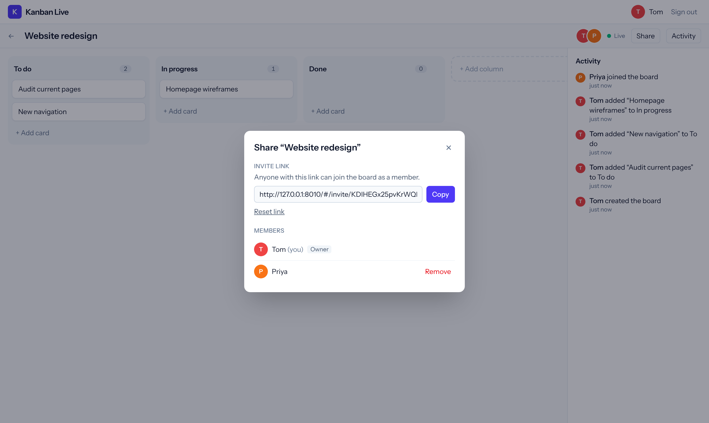

# Kanban Live

[](https://github.com/GodfreysDragon/realtime-kanban/actions/workflows/ci.yml)

A real-time collaborative Kanban board built with **Laravel 13, Laravel Reverb (WebSockets), Laravel Echo and Vue 3**.
Open it in two browsers and every change shows up in both instantly: cards, moves, edits, who's online, where their
cursor is, and what they're editing. When two people edit the same card, the app catches it and asks the second person
how to resolve the conflict.

The project is about real-time, stateful work beyond plain request and response:
- presence;
- client-to-client messages;
- optimistic UI;
- concurrency control;
- recovering after a disconnect.

**Stack:** Laravel 13 · PHP 8.4 · Laravel Reverb (WebSocket server, Pusher protocol) · Laravel Echo + pusher-js · Vue 3 ·
Tailwind 4 · SQLite (any Laravel database works)


<details>
<summary>More screenshots</summary>

Grace's view while she edits the card, with Ada's cursor:


Sharing a private board: the invite link and its members:



Phone width:


</details>

## Running it

Requirements: PHP 8.4+, Composer, Node 20+.

```sh
composer install
cp .env.example .env            # includes local Reverb credentials
php artisan key:generate
php artisan migrate --seed      # seeds a "Product launch" demo board
npm install && npm run build
composer run dev                # app server, Reverb, queue worker and Vite together
```

Then open http://localhost:8000 in one browser, open it again in a private window, and join with two different names.
The seeded *Product launch* board is public, so both can open it straight away. Boards you create are private: use
**Share** to copy an invite link for the other window.

If you run the processes by hand, the two that matter are `php artisan serve` and `php artisan reverb:start`.

### If port 8000 is already taken
`composer run dev` always serves the app on port 8000. If something else is listening there, you may see a different
site, or a join form that never appears. On Windows `artisan serve` can even bind the same port without an error. Stop
the other server, or start the processes by hand on a free port:

```sh
php artisan reverb:start              # WebSockets on 8080
php artisan serve --port=8010         # then open http://localhost:8010
npm run dev                           # only when editing frontend code; otherwise run npm run build once
E2E_URL=http://127.0.0.1:8010 npm run test:e2e
```

Nothing else needs to change: the WebSocket URL comes from the `REVERB_*` settings, not the app's port.

### Deploying
Set `REVERB_ALLOWED_ORIGINS` to the comma-separated hosts allowed to open WebSocket connections (for example
`kanban.example.com`). It defaults to `*`, which is fine locally.

## What happens in real time

| Feature | Mechanism |
|---|---|
| Cards and columns created, edited, moved and deleted | Server events on a **presence channel** `presence-board.{id}` |
| Who's online (avatar stack) | Presence channel membership (`here` / `joining` / `leaving`) |
| Live cursors | Client **whispers** (`client-cursor`), throttled to about 20/s, never touch PHP |
| "Ada is editing" and "Ada is moving" badges | Whispers (`client-editing`, `client-dragging`) |
| Who sent a whisper | The `user_id` Reverb adds to each one from the sender's channel auth, never the payload |
| Activity feed | `activity.recorded` event, sent to everyone including the actor |
| Connection status and resync | pusher-js `state_change` drives the badge. Every (re)subscription to the channel fetches the board snapshot again |
| Lost messages | Every event carries a per-board sequence number; a gap that doesn't fill within 3 s triggers a resync |

## Design decisions

### Sync model
The REST snapshot (`GET /api/boards/{id}`) is the source of truth. Every server event carries the **full row** rather
than a diff, so applying an event is idempotent and replays are harmless. The snapshot is fetched once straight away for a fast
first paint and again when the channel subscription succeeds, because only a snapshot taken after that moment is
guaranteed not to miss an event. While a snapshot is loading, incoming events are buffered and replayed after it, and if
loads overlap only the newest is applied. Pusher-protocol servers don't replay missed messages, but every reconnect
re-subscribes, so the same hook fetches the snapshot again.

### Sequence numbers
Reconnects are covered by re-fetching, but a message can also go missing while the socket stays up. Every event
therefore takes the board's next sequence number (`boards.event_seq`, `App\Services\BoardSequence`) when it is
created, which is after the change it describes has committed. The snapshot reports the board's number, read before
its data, so it already contains every event up to that number: the client drops those and applies only later ones.

The client tracks the highest number up to which it has seen everything. A number that stays missing for 3 seconds
means a lost message, and the snapshot is fetched again. The grace period absorbs events from concurrent requests
arriving slightly out of order. Events sent `->toOthers()` never reach the tab that caused them, so every response
lists the numbers it broadcast in an `X-Board-Events` header (`board:seq,…`), and that tab counts them as seen.

### No echo of your own changes
The client applies its own changes optimistically. Every API call sends `X-Socket-ID`, and the server broadcasts with
`->toOthers()`, so the tab that made a change never receives it back. The HTTP response then replaces the optimistic
value with the server's.

Moves of the same card or column are sent one at a time. Two requests in flight together can be handled by different
PHP workers in either order, which would leave the server on the older move while the tab shows the newer one. While
one move is in flight only the newest waiting move is kept, and it is sent when the first returns.

### Ordering with fractional indexes
Each card has a float `position`. Dropping a card between two others gives it the midpoint of their positions, so a
move rewrites exactly **one row**, and two people reordering different cards never conflict. The client sends the card
it was dropped *after* (`after_id`) rather than an index, and the server resolves it against the current database
state. If that neighbour has meanwhile been moved elsewhere, the card goes to the bottom instead of failing. Repeated
drops into the same gap halve it each time. Below `1e-6` the column is renumbered and a `column.rebalanced` event pushes
the new positions to everyone.

Columns are ordered the same way on the board (`PATCH /api/columns/{id}/move`, `column.moved`, and
`columns.rebalanced` when the board's columns are renumbered). Both use `app/Services/FractionalIndex.php`. It takes a
query for the *other* rows in the list, scoped to that list, and every write goes through the same query, so a row that
has meanwhile left the list is never renumbered into it.

### Conflicting edits: optimistic concurrency
Cards carry a `version`. A save is a conditional `UPDATE … WHERE version = ?`. If no row is affected, someone else
saved first, and the API returns **409** with the current card and who changed it. The editor then shows both versions
with *Use theirs* / *Overwrite with mine*. If someone else saves while your dialog is open:
- with no edits of your own, the dialog quietly follows their change;
- if you've made edits, a banner warns you and your text is kept.

Moves are deliberately last-writer-wins; there is nothing to merge. They don't bump `version`, so dragging a card never
turns someone else's open edit into a conflict. A move does broadcast the card as it is *after* the write, so an edit
saved while the move was in flight is never undone on other screens.

### Locking
Moving or adding a card locks its column row for the length of the transaction, so two writers can't compute positions
from the same snapshot of the column. A rebalance only renumbers cards that are still in that column, so a card someone
else just moved out keeps its new place. `lockForUpdate()` does nothing on SQLite, so the SQLite connection starts every
transaction `IMMEDIATE` instead: concurrent writers queue for the database lock rather than failing with
"database is locked".

### Membership
A board is private to its members unless it's public. `BoardPolicy::view` decides, and the same rule guards every API
endpoint and the `board.{board}` presence channel, so the REST snapshot and the live view can't disagree about who
sees a board. Card endpoints check it in their form requests' `authorize()`, which runs before validation, so an
outsider gets a 403 rather than validation errors.

People join through the board's **invite link** (`#/invite/{token}`). A link opened while signed out survives the
sign-in, because joining reloads the page with the hash intact. The owner can reset the link, which makes the old one
stop working, and remove members. A member can leave. Removal is broadcast as `member.removed` to everyone, the removed
person included, and their tab leaves the board. The API refuses their requests from then on.

Channel authorisation only runs when a socket subscribes, so a modified client could ignore that event and stay
subscribed. On a private board the server also closes the removed person's sockets (`app/Services/LiveConnections.php`,
through Pusher's `terminate_connections`, which Reverb implements). Their client reconnects and subscribes again, and
that subscription is checked against the new membership and refused. Their other tabs and boards reconnect too and
re-sync from a snapshot.

### Synchronous broadcasts
Events implement `ShouldBroadcastNow`. Queued broadcasts with several workers can arrive out of order ("moved" before
"created"), and the cost of handing a message to a local Reverb server inside the request is a few milliseconds. A
high-traffic deployment would use a single ordered queue, with the per-board sequence numbers catching anything that
still arrived out of order.

### Drag and drop on Pointer Events
The native HTML5 drag API never fires for touch, so cards and columns are dragged with Pointer Events instead
(`resources/js/lib/pointerDrag.js`), which covers mouse, touch and pen with one code path:
- With a mouse or pen, the drag starts after a few pixels of movement, so a plain click still opens the card.
- On a touch screen it starts after a 300 ms press without moving. Moving sooner is a scroll, so the board stays
  scrollable by swiping across cards. Once a drag starts, the first `touchmove` is cancelled so the page doesn't scroll
  under the finger.
- A copy of the card follows the pointer, scroll containers under it scroll near their edges, and Escape cancels.
- The board decides what's under the pointer (`elementFromPoint`) and where the drop indicator goes.
- A column's header is its drag handle, apart from the delete button.

### Keyboard and screen readers
- Cards open with Enter or Space.
- Alt+↑/↓ moves the focused card within its column, and Alt+←/→ moves it to the same position in the neighbouring
  column. Focus stays on the card, and the new position is announced (“Moved “Press kit” to position 2 of 3 in
  Review”).
- On a column's name, Alt+←/→ moves the column one place.
- The card dialog keeps Tab inside it and returns focus to the card when it closes.
- Escape, Cancel or a click outside ask before throwing away unsaved edits.
- Board and column names are renamed through real buttons.
- Errors after the first load, such as a failed resync or a refused channel connection, appear in a banner with
  Retry rather than leaving a stale board on screen without saying so.

## Tests

```sh
php artisan test          # 59 PHPUnit feature tests
npm run test:e2e          # two headless browsers against a running app + Reverb (see below)
```

- **PHPUnit** covers:
  - auth;
  - membership: every endpoint and the channel refuse outsiders, invite links, resetting a link, removing and leaving,
    and closing a removed member's sockets;
  - board, column and card CRUD;
  - broadcast dispatch, payloads and `toOthers` socket exclusion;
  - version conflicts;
  - sequence numbers: one per broadcast, per board, reported in the snapshot and the `X-Board-Events` header;
  - races where another request commits mid-move, reproduced deterministically by hooking Eloquent's `retrieved`
    event;
  - fractional positioning of cards, including a 60-drop stress test that forces a rebalance, and of columns;
  - cross-board validation;
  - real `/broadcasting/auth` presence signing with the Reverb driver.
- **End-to-end** (`tests/e2e/two-users.mjs`) drives two signed-in users in headless Edge/Chrome through `playwright-core`,
  using the installed browser so nothing is downloaded. It checks:
  - joining through an invite link, after being refused without one;
  - presence;
  - card creation;
  - live cursors;
  - drag and drop between columns;
  - the activity feed;
  - editing badges;
  - the full 409 conflict flow;
  - disconnect → missed event → reconnect → resync;
  - sequence numbers: ordinary traffic causes no resync, and a message dropped on an open socket is noticed and
    resynced;
  - keyboard: Enter opens a card, focus stays in the dialog, Escape returns focus to the card;
  - keyboard moves: Alt+Arrow moves a card to another column, keeps focus on it and announces it;
  - reordering within a column by mouse;
  - reordering columns by dragging a header, and with Alt+Arrow on a column name;
  - touch, through Chrome's DevTools protocol: a long press then drag moves a card, a quick swipe scrolls instead;
  - delete propagation, including closing the dialog of someone who had the card open;
  - whispers: a client that claims to be someone else still shows up under its own name;
  - removing a member, whose tab is sent back to the board list, and whose socket stops receiving the board even when
    a modified client refuses to leave.

  Set `E2E_URL` if the app isn't on `http://127.0.0.1:8000`, and `E2E_BROWSER_PATH` to use a Chromium binary other
  than an installed Edge or Chrome. Screenshots land in `storage/e2e/`.

Both suites run in GitHub Actions on every push (`.github/workflows/ci.yml`). The e2e job builds the assets and
starts Reverb and the app server first.

## Simplifications

- **Sign-in is "join with a display name"** (`AuthController`), which creates a guest user so the demo needs no
  registration. The session guard, CSRF and presence-channel auth downstream are standard and would work unchanged with
  Fortify or a starter kit.
- **Members and the owner are the only roles.** There are no read-only members, and a board's ownership can't be
  transferred.
- **One Reverb server.** Scaling across several servers (Redis pub/sub) isn't configured; Reverb supports it with
  `REVERB_SCALING_ENABLED`.

## License

MIT. See [LICENSE](LICENSE).
